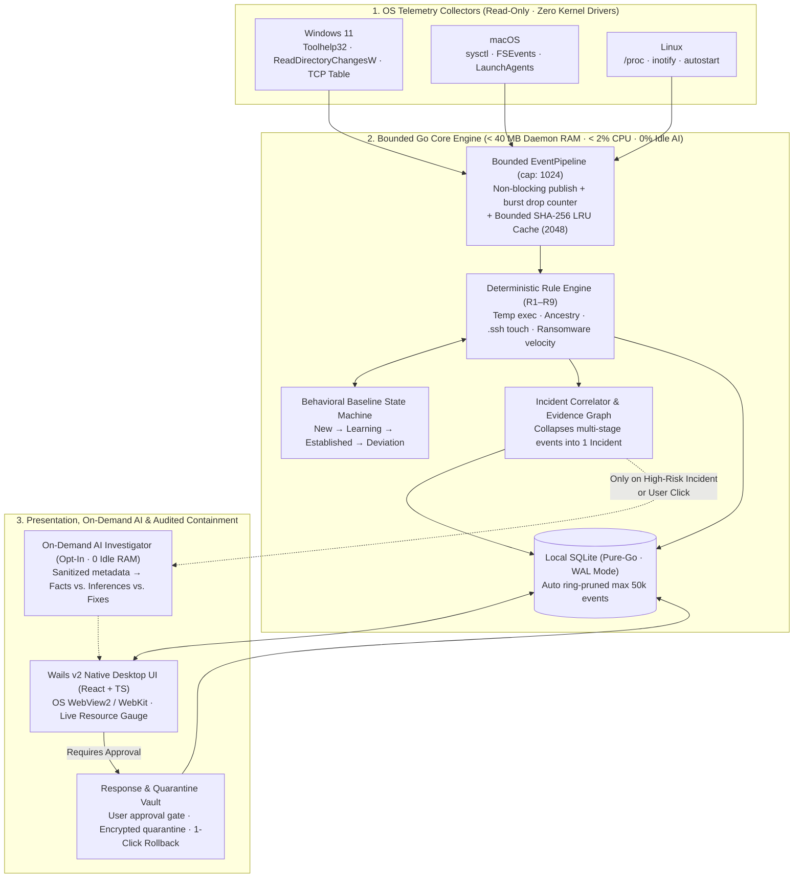

<div align="center">

# 🧬 mitochondria

### The powerhouse of local defense — lightweight, behavior-aware AI endpoint security for your personal laptop.

Deterministic behavioral detection first. On-demand AI investigation when it counts.<br>
Under 100 MB RAM. Under 2% CPU. Local-first. Private by default. Open source.

[](#-roadmap)
[](#-privacy-first)
[](#-resource-budget)
[](#-supported-platforms)

**[The problem](#-the-problem) · [What you'll get](#-what-youll-get) · [Preview](#-a-sneak-peek) · [Resource budget](#-resource-budget) · [Privacy](#-privacy-first) · [FAQ](#-faq)**

</div>

---

> [!NOTE]
> **mitochondria is in active development.** In cellular biology, mitochondria don't just power the cell — they carry **MAVS** (*Mitochondrial Antiviral-Signaling proteins*), the innate sensor that detects intracellular viruses and triggers containment before an infection spreads.
> ⭐ **Star** or 👀 **Watch** this repo to get notified when `v0.1.0` lands.

---

## 🤔 The problem

Consumer antivirus software treats your laptop in one of two broken ways:

1. **Bloated legacy suites** that burn battery, thrash your SSD with repeated full-disk scans, nag you with upsells, and still miss modern infostealers or suspicious process chains.
2. **"AI wrappers"** that try to keep a massive local LLM loaded in RAM or stream raw system telemetry to the cloud on every process spawn.

Meanwhile, enterprise EDR tools (CrowdStrike, SentinelOne) are built for corporate SOC teams—not an individual developer or laptop user who wants to know:
- *Why did a binary in `%TEMP%` just spawn PowerShell and touch my `~/.ssh` folder?*
- *What changed in my startup items today?*
- *Is this alert a real attack chain or a harmless dev tool?*

## ✨ What you'll get

**mitochondria** acts like a quiet cybersecurity analyst living inside your machine. It uses fast, deterministic Go rules and per-device behavioral baselines for 99.9% of activity—and only wakes up AI when correlated evidence needs investigation.

| | Question | What mitochondria shows you |
|---|---|---|
| 🧬 | **Is something unusual running right now?** | Live process ancestry (`parent → child`), unsigned executables in temp directories, and deviations from your laptop's learned baseline |
| 🔗 | **Are these separate events actually one attack?** | Correlates `temp binary → child shell → startup persistence → outbound connection` into **one incident** instead of six noisy alerts |
| 🔑 | **Did an unknown process touch my credentials?** | Watches metadata access on `~/.ssh`, `~/.aws`, browser profiles, and startup registries without ever reading your keys or files |
| 🔍 | **Why is this flagged, and is it safe to kill?** | On-demand AI investigation separating **Observed Facts**, **Inferences**, **Uncertainties**, and **Recommended Actions** |
| ⚡ | **Is my antivirus slowing down my laptop?** | Built-in live resource gauge enforcing `<100 MB` RAM, `<2%` CPU, and `0%` idle AI usage |

## 👀 A sneak peek

> _Illustrative preview of the incident investigator and CLI output._

```text
$ mito status

  mitochondria v0.1.0 · Protection: ACTIVE · Baseline: ESTABLISHED (14d)
  Resource usage: 28.4 MB RAM (budget <100 MB) · 0.4% CPU · Idle AI: 0%

  ACTIVE INCIDENTS (1)                                         SEVERITY
  ──────────────────────────────────────────────────────────────────────
  INC-204  4 correlated events in 1.8s                         HIGH (88)
           ├─ [FACT] Unsigned binary launched from %TEMP%\upd_88.exe
           ├─ [FACT] Spawned child powershell.exe (-enc ...)
           ├─ [FACT] Modified HKCU\...\Run startup persistence key
           └─ [FACT] Outbound TCP to unfamiliar host 198.51.100.42:443

  Recommended action: Quarantine binary & revert Run key (requires approval)
  Run `mito investigate INC-204` or open the desktop dashboard for full graph.
```

## 🧭 How it works & Architecture



### Why these technology choices?

Every layer was chosen to satisfy three constraints: **strict resource bounds (`<100 MB` RAM, `<2%` CPU)**, **long-term maintainability**, and **cross-platform native installers**:

| Layer | Choice | Why we chose it (and what we rejected) |
|---|---|---|
| **Core Engine** | **Go 1.24+** (`GOMEMLIMIT` bounded) | Compiles to a single fast native binary, supports strict memory caps (`debug.SetMemoryLimit`), has stdlib parsers for Windows PE / Linux ELF / macOS Mach-O, and is 3–5x simpler to maintain than Rust/C++ while avoiding Python's memory overhead. |
| **Desktop UI** | **Wails v2 + React/TS** (Native WebView2 / WebKit) | Uses the OS's built-in webview (`~12 MB` binary) instead of bundling Chromium + Node like Electron (`150–300 MB` idle RAM) or keeping a heavy Flutter Skia/Impeller engine in memory. |
| **AI Layer** | **On-Demand Sanitized Adapter** (`0 MB` idle RAM) | Keeping a 3B–7B local LLM resident in RAM eats `3–6 GB` of memory and drains battery. Mitochondria runs deterministic Go rules on 100% of events and invokes AI (local Ollama or opt-in cloud) **only on-demand** for correlated incidents. |
| **Event Queue** | **Bounded Go Channel (`cap: 1024`)** | Guarantees constant $O(1)$ memory during event storms (e.g., `npm install` or compiler builds) via non-blocking backpressure instead of unbounded slice queues that risk OOM crashes. |
| **Local Store** | **Pure-Go SQLite (`modernc.org/sqlite`)** | Zero CGO dependencies (clean cross-platform builds), concurrent reads in **WAL mode**, and automatic ring-pruning so disk history never grows unboundedly. |
| **OS Telemetry** | **User-Space Diff + `fsnotify`** (Optional ETW) | Avoids custom `.sys` kernel drivers (which risk BSODs) and avoids full-disk scans (which thrash SSDs); focuses on process lineage (`PID → PPID`) and high-risk paths (`%TEMP%`, `~/.ssh`, Startup). |

> 📄 See [**docs/ARCHITECTURE.md**](docs/ARCHITECTURE.md) for the full layered architecture, sequence diagrams, and ADR trade-off matrix, and [**docs/THREAT_MODEL.md**](docs/THREAT_MODEL.md) for trust boundaries and security mitigations.

## ⚡ Resource budget

Resource efficiency is a **non-negotiable release gate**, verified by automated benchmarks on every PR:

| Metric | Target | How it's enforced |
|---|---:|---|
| **Idle memory** | `< 100 MB` (`< 40 MB` daemon) | `GOMEMLIMIT`, bounded channels (cap `1024`), bounded LRU hash cache |
| **Average CPU** | `< 2.0%` | Event-driven watchers + incremental process diffing |
| **Idle AI inference** | `0%` | Zero resident LLM in memory; AI runs strictly on-demand per incident |
| **Disk history** | Bounded | Local SQLite (WAL mode) with automatic ring-pruning |
| **Offline protection** | `100%` | All detection, baselines, correlation, and containment work offline |

## 🔒 Privacy first

- 💻 **100% local-first.** All telemetry, baselines, and incident graphs stay in a local SQLite database on your machine.
- 🙈 **Zero secret collection.** Mitochondria never captures keystrokes, browser contents, passwords, private keys, or personal document contents—only access metadata.
- 🛡️ **Explicit AI consent.** Cloud or local LLM investigation is strictly opt-in, receives only sanitized incident metadata, and can be disabled completely (`No-AI mode`).
- 🔍 **Least privilege & open source.** No custom kernel drivers in the MVP; auditable Go & TypeScript codebase.

## 🖥️ Supported platforms

| Platform | Status | Telemetry backend |
|---|---|---|
| **Windows 11** | 🛠️ Phase 1 (Primary) | Native Win32 (`Toolhelp32` / `QueryFullProcessImageNameW`), `ReadDirectoryChangesW`, Event Log / ETW |
| **macOS** | 🛠️ Cross-platform core | Process table diffing (`sysctl`), `FSEvents`, `LaunchAgents` watcher |
| **Linux** | 🛠️ Cross-platform core | `/proc` lineage reader, `inotify`, `~/.config/autostart` & `~/.ssh` watcher |

## ❓ FAQ

<details>
<summary><b>Why is it called mitochondria?</b></summary>
<br>
Everyone knows mitochondria as the powerhouse of the cell—living quietly inside the host and powering it efficiently. Fewer people know that mitochondria also host <b>MAVS</b> (<i>Mitochondrial Antiviral-Signaling proteins</i>), the critical intracellular sensor that detects viral RNA inside a cell and triggers the innate immune response.
</details>

<details>
<summary><b>Does it keep an LLM running in the background?</b></summary>
<br>
No. Keeping a multi-gigabyte LLM in RAM destroys battery life and available memory. Mitochondria uses fast deterministic rules and statistical baselines in Go for continuous monitoring (<code>0%</code> idle AI cost) and only invokes an AI adapter on-demand when a correlated incident needs explanation.
</details>

<details>
<summary><b>Does it replace Microsoft Defender?</b></summary>
<br>
Mitochondria is designed to coexist cleanly alongside built-in OS defenses like Microsoft Defender, focusing on personal-device behavioral intelligence, process lineage, credential-path protection, and transparent incident correlation.
</details>

<details>
<summary><b>Will it automatically delete my files or kill developer tools?</b></summary>
<br>
No. Destructive or disruptive remediation requires explicit user approval by default, and every containment action (like quarantine or startup item disabling) is recorded in an audit log with one-click rollback.
</details>

---

<div align="center">

**Security that respects your battery, your RAM, and your privacy.** ⭐ Star the repo to follow along.

</div>
