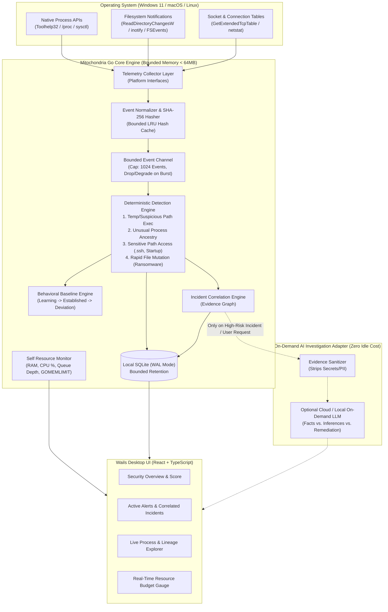

# Mitochondria — Architecture & Resource Budget

**Mitochondria** is a privacy-first, behavior-aware personal endpoint security application built with **Go + Wails v2 + React/TypeScript**. Like the organelle it is named after—which powers the cell from within and triggers innate antiviral signaling (MAVS)—Mitochondria runs locally on the endpoint with strict resource bounds and zero idle AI overhead.

---

## 1. Repository Structure

```text
mitochondria/
├── cmd/
│   └── mitod/                  # Standalone headless endpoint daemon binary (optional CLI/service mode)
├── docs/
│   ├── ARCHITECTURE.md         # System architecture, telemetry strategy, and resource budgets
│   └── THREAT_MODEL.md         # Security & privacy threat model, trust boundaries, mitigations
├── internal/
│   ├── models/                 # Normalized telemetry events, alerts, incidents, resource metrics
│   ├── telemetry/              # OS-abstracted collectors (Windows/macOS/Linux process & filesystem)
│   ├── storage/                # Bounded SQLite persistence layer (WAL mode, auto-pruning)
│   ├── detection/              # Deterministic rule engine + statistical baseline tracker
│   ├── correlation/            # Incident correlation & evidence graph builder
│   ├── monitor/                # Self-monitoring (RAM, CPU, queue depth, GOMEMLIMIT enforcement)
│   └── daemon/                 # Central orchestrator connecting collectors, storage, and detection
├── frontend/                   # React + TypeScript + Vite desktop dashboard (Wails WebView2/WebKit)
├── app.go                      # Wails IPC bridge binding the Go daemon to the desktop UI
├── main.go                     # Desktop application entry point
└── wails.json                  # Cross-platform packaging & installer configuration
```

---

## 2. System Architecture Diagram



---

## 3. Measurable Resource Budget & Enforcement

Resource efficiency is a **non-negotiable architectural invariant**.

| Metric | Target | Enforcement Mechanism in Go |
| :--- | ---: | :--- |
| **Daemon Idle RAM** | `< 40 MB` (Target `< 100 MB` w/ UI) | `debug.SetMemoryLimit(64 * 1024 * 1024)` (`GOMEMLIMIT=64MiB`) + aggressive GC |
| **Average CPU** | `< 2.0%` | Differential snapshot & event-driven `fsnotify` (no full-disk scans) |
| **Idle AI Inference** | `0%` CPU / `0 MB` RAM | No resident local LLM loaded in memory; AI is strictly an on-demand HTTP/IPC adapter |
| **Event Queue Depth** | Hard-capped at `1024` | Bounded Go channel (`chan TelemetryEvent`, cap 1024) with non-blocking backpressure metrics |
| **Hash Cache Memory** | Hard-capped at `2048` entries | Bounded in-memory cache keyed by `(path, mtime, size)` to avoid re-hashing unchanged binaries |
| **SQLite Disk Growth** | Bounded (`max 50,000` events) | SQLite WAL mode with periodic ring-pruning of routine low-severity telemetry |

---

## 4. Cross-Platform & Windows 11 Telemetry Strategy

To avoid kernel instability (no custom `.sys` kernel drivers in MVP) and support both unprivileged user sessions and elevated service deployments:

1. **Process Creation, Termination & Ancestry:**
   - **Windows 11:** Uses native Win32 `CreateToolhelp32Snapshot` (`TH32CS_SNAPPROCESS`) + `OpenProcess(PROCESS_QUERY_LIMITED_INFORMATION)` + `QueryFullProcessImageNameW` via `golang.org/x/sys/windows`. Takes ~0.4ms per differential pass, captures PID, PPID (parent process ID), executable path, and SHA-256 hash of newly spawned processes without requiring Administrator rights. (Extensible to ETW `Microsoft-Windows-Kernel-Process` when running as an elevated service).
   - **Linux / macOS:** Uses `/proc/<pid>/stat` + `/proc/<pid>/exe` on Linux and `ps`/`sysctl` process table diffing on macOS behind the same `ProcessCollector` interface.
2. **Sensitive Filesystem & Persistence Monitoring:**
   - Event-driven via OS kernel notifications (`ReadDirectoryChangesW` on Windows, `inotify` on Linux, `FSEvents` on macOS).
   - Watches high-risk directories rather than the entire drive:
     - User Temp & Downloads directories (staging ground for droppers)
     - `~/.ssh`, `~/.aws`, `~/.gnupg` (credential access metadata—never file contents)
     - Windows Startup folder (`%APPDATA%\Microsoft\Windows\Start Menu\Programs\Startup`) / macOS `LaunchAgents` / Linux `~/.config/autostart`.
3. **Ransomware Canary / Burst Detection:**
   - Sliding-window rate counter tracking file modification/rename velocity (`events/sec`) in monitored user directories.
