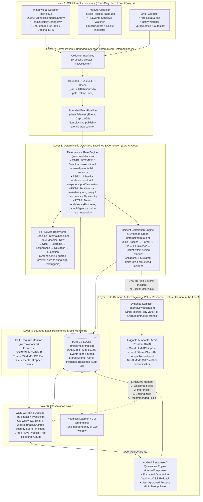
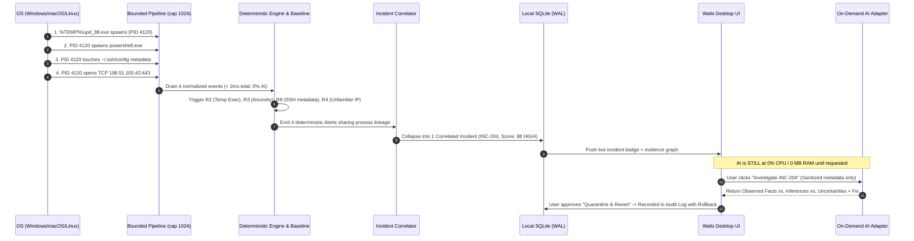

# Mitochondria — Detailed System Architecture & Technology Choices

**Mitochondria** is a privacy-first, behavior-aware personal endpoint security application built with **Go + Wails v2 + React/TypeScript**. Like the cellular organelle it is named after—which powers the cell from within and hosts **MAVS** (*Mitochondrial Antiviral-Signaling proteins*) to trigger innate intracellular immunity—Mitochondria runs locally on the endpoint with strict resource bounds (`< 100 MB` RAM, `< 2%` CPU) and **zero idle AI overhead**.

---

## 1. Layered System Architecture Diagram



---

## 2. End-to-End Incident Lifecycle (Why Idle AI = 0%)



---

## 3. Architectural Decisions & Technology Choices (ADR Matrix)

Every architectural choice in Mitochondria is evaluated against three constraints: **Resource Budget (`< 100 MB` RAM, `< 2%` CPU)**, **Maintainability**, and **Cross-Platform Portability (Windows 11, macOS, Linux)**.

| Layer | Chosen Technology | Alternatives Considered | Why We Chose This (Engineering Rationale) |
| :--- | :--- | :--- | :--- |
| **1. Core Daemon & Engine Language** | **Go 1.24+** (`GOMEMLIMIT` bounded runtime) | • **Rust**<br>• **Python**<br>• **C / C++** | **Go** compiles to a single fast native binary, supports strict memory caps via `debug.SetMemoryLimit`, has built-in concurrency primitives (bounded channels) ideal for event pipelines, parses PE/ELF/Mach-O natively in stdlib, and is **3–5x faster to read, test, and maintain** than Rust. Python violates the `< 100 MB` RAM budget; C/C++ introduces memory-safety risks in a security tool. |
| **2. Desktop Application Framework** | **Wails v2 + React + TypeScript** (OS-native WebView2 / WebKit) | • **Electron**<br>• **Flutter Desktop**<br>• **Tauri (Rust)** | **Electron** bundles a full Chromium browser + Node runtime (`150–300 MB` idle RAM), immediately failing our resource budget. **Flutter Desktop** keeps a heavy Skia/Impeller graphics engine in memory (`80–140 MB`) and splits the codebase into Dart. **Wails v2** uses the OS's built-in WebView (`WebView2` on Windows 11, `WKWebView` on macOS, `WebKitGTK` on Linux), produces a `~12 MB` binary, and binds directly to Go structs with zero HTTP serialization overhead when the window is closed. |
| **3. AI Investigation Architecture** | **On-Demand Pluggable Adapter** (Sanitized HTTP/IPC client; `0 MB` idle RAM) | • **Resident Local LLM** (e.g., 7B GGUF always loaded)<br>• **Always-On Cloud Streaming** | Keeping even a quantized 3B–7B LLM resident in RAM consumes **2.5 GB to 6 GB of RAM**, destroying laptop battery life and violating `< 100 MB`. Streaming every process event to the cloud violates user privacy and costs money. By running deterministic Go rules on 100% of events and invoking the AI adapter **only on-demand** for correlated incidents, idle AI resource consumption is **strictly zero**. |
| **4. Local Persistence Store** | **Pure-Go SQLite** (`modernc.org/sqlite`) in **WAL Mode** with Ring-Pruning | • **CGO SQLite (`mattn/go-sqlite3`)**<br>• **In-Memory Maps / JSON files**<br>• **BadgerDB / BoltDB** | `modernc.org/sqlite` is a mechanical C-to-Go translation of SQLite: it requires **zero CGO**, making cross-compilation across Windows/macOS/Linux trivial, while supporting concurrent reads via **Write-Ahead Logging (WAL)** and relational queries for the incident correlator. Automatic ring-pruning caps total rows so disk usage never grows unboundedly. |
| **5. Event Ingestion & Backpressure** | **Bounded Go Channel (`cap: 1024`) + Atomic Drop Counter** (`internal/pipeline`) | • **Unbounded Dynamic Slice Queue**<br>• **Blocking Unbuffered Channel**<br>• **External Broker (Kafka/Redis)** | During a compiler build or `npm install`, an OS can generate 10,000+ file/process events per second. An unbounded queue causes an OOM crash; a blocking channel stalls the collector. A fixed `1024`-slot ring buffer with non-blocking `select` guarantees **constant O(1) memory** and records dropped-event telemetry for graceful degradation. |
| **6. OS Telemetry Collection** | **User-Space Native APIs + `fsnotify` (2-Tier Capability Model)** | • **Custom Kernel Driver (`.sys` / kext)**<br>• **Repeated Full-Disk File Scans** | Custom kernel drivers risk BSODs/kernel panics and require expensive EV hardware code-signing certificates. Full-disk scans thrash SSDs and burn CPU. Instead, Mitochondria uses lightweight differential process snapshots (`Toolhelp32` on Windows, `/proc` on Linux, `sysctl` on macOS) + kernel-backed directory notifications (`ReadDirectoryChangesW` / `inotify` / `FSEvents`) on high-value paths (`%TEMP%`, `~/.ssh`, Startup), with optional ETW elevation on Windows. |
| **7. Testability & PR Workflow** | **Interface-First Dependency Injection** (`internal/core/interfaces.go`) | • **Direct OS Syscalls Inside Business Logic** | Every external boundary (`ProcessCollector`, `FileCollector`, `EventStore`, `Detector`, `ResourceSampler`) is an interface in `internal/core`. This enables **Step-1 TDD**: every PR starts with 100% mocked, deterministic unit tests before any OS-specific or database code is wired up. |

---

## 4. Measurable Resource Budget & Enforcement

Resource efficiency is a **non-negotiable release gate** tested in CI:

| Metric | Target | Enforcement Mechanism in Go |
| :--- | ---: | :--- |
| **Daemon Idle RAM** | `< 40 MB` (`< 100 MB` w/ UI) | `debug.SetMemoryLimit(64 * 1024 * 1024)` (`GOMEMLIMIT=64MiB`) + bounded structs |
| **Average CPU** | `< 2.0%` | Differential process snapshot (`~0.4ms`) & event-driven `fsnotify` (zero full-disk polling) |
| **Idle AI Inference** | `0%` CPU / `0 MB` RAM | No resident local model in memory; AI runs strictly on-demand per correlated incident |
| **Event Queue Depth** | Hard-capped at `1024` | `pipeline.EventPipeline` (`chan TelemetryEvent`, cap 1024) with non-blocking drop counter |
| **Hash Cache Memory** | Hard-capped at `2048` entries | Bounded LRU cache keyed by `(path, mtime, size)` so unchanged system binaries are hashed once |
| **SQLite Disk History** | Bounded (`max 50,000` events) | SQLite WAL mode with `PruneOldEvents` ring-pruning |

---

## 5. Repository Structure

```text
mitochondria/
├── cmd/
│   └── mitod/                  # Standalone headless endpoint daemon binary (CLI/service mode)
├── docs/
│   ├── ARCHITECTURE.md         # Detailed architecture diagrams, ADR choices, and resource budget
│   └── THREAT_MODEL.md         # Security & privacy threat model, trust boundaries, mitigations
├── internal/
│   ├── core/                   # OS-neutral domain types (TelemetryEvent, Alert, Incident) & interfaces
│   ├── pipeline/               # Bounded non-blocking EventPipeline (cap: 1024) with burst backpressure
│   ├── storage/                # Pure-Go SQLite WAL store with automatic ring-pruning
│   ├── monitor/                # Self-resource monitor (RAM MB, CPU %, GOMEMLIMIT enforcement)
│   ├── telemetry/              # Platform-specific collectors (Windows 11 / macOS / Linux)
│   ├── detection/              # Deterministic rule modules (R1–R9)
│   ├── baseline/               # Per-device statistical baseline engine & anti-poisoning state machine
│   ├── correlation/            # Evidence graph & multi-event incident correlator
│   ├── investigation/          # Evidence sanitizer & pluggable on-demand AI adapter
│   └── response/               # Encrypted quarantine vault, approval gates, and rollback audit log
├── frontend/                   # React + TypeScript + Vite desktop dashboard (Wails v2)
├── app.go                      # Wails IPC bridge binding the Go engine to the desktop UI
├── main.go                     # Desktop application entry point
└── wails.json                  # Cross-platform packaging & native installer configuration
```
